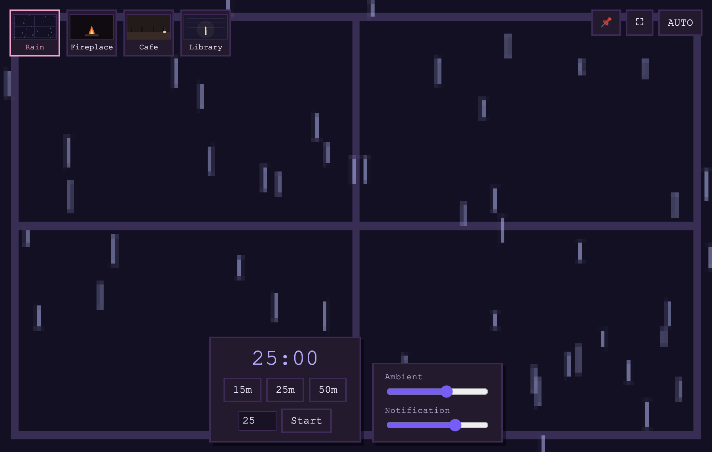
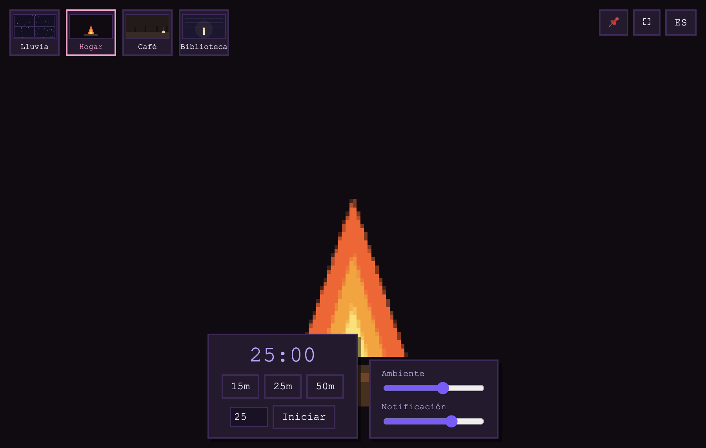

# Study Room Pixel

[](https://github.com/malenitaa/study-room-pixel/releases/latest)
[](./LICENSE)
[](#)
[](./SECURITY.md)

A free desktop app for Mac and Windows that shows an ambient pixel-art scene —
**rain, fireplace, café, or library** — with looping audio and a built-in
study/focus timer. Meant to run quietly in the background while you work.

Zero network, zero accounts, zero telemetry — everything is local. The
interface is available in **English and Spanish** (it follows your system
language; the button in the top-right corner switches it).

<p align="center">
  
</p>
<p align="center">
  
</p>

## Installation

See [`INSTALL.md`](./INSTALL.md) for a simple, no-terminal, step-by-step guide
(including how to get past the unsigned-app warnings on macOS and Windows).

Short version: download the `.dmg` (Mac) or the `Setup .exe` (Windows) from
[Releases](https://github.com/malenitaa/study-room-pixel/releases) and install
it like any other app.

## Features

- Four ambient scenes (rain, fireplace, café, library), switch instantly.
- Independent ambient/notification volume controls.
- A focus timer with preset durations or custom minutes.
- "Always on top" pin so it stays visible while you work in another app.
- Fullscreen mode.
- English/Spanish interface — AUTO follows your system language, or force
  either one with the toggle in the top-right corner.

## Privacy

- **No network, ever.** There is no network code in the app, and the
  production build blocks outgoing connections at the browser-engine level
  on top of that. The ambient audio is bundled inside the app, never
  streamed.
- **One local file.** The only thing it remembers (chosen scene, volumes,
  last timer duration, language) lives in a single small JSON file in your
  user's application data folder.
- **No accounts, no telemetry, no auto-update phoning home.** Updates are
  manual, from the Releases page.
- Full threat model, verifiable against the code: [SECURITY.md](./SECURITY.md).

## For developers

Requirements: Node.js 20+.

```bash
git clone https://github.com/malenitaa/study-room-pixel.git
cd study-room-pixel
npm install
npm run dev       # dev mode with hot reload
npm run dist      # builds the macOS .dmg into dist/
npm run dist:win  # builds the Windows installer into dist/
```

## Enjoyed it?

If this was useful and you'd like to support the project:

- [Cafecito](https://cafecito.app/rezamalena)
- [Ko-fi](https://ko-fi.com/malenitaa)

## License

MIT — see [LICENSE](./LICENSE).
